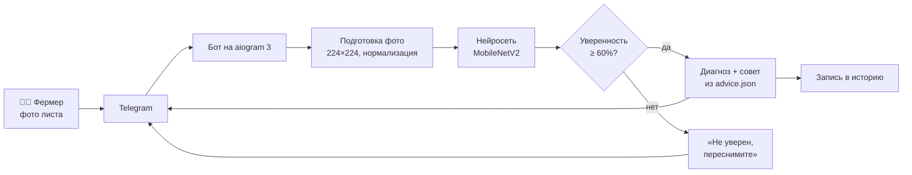

# 🌾 RiceDoctor AI · Күріш дәрігері AI

**Telegram-бот, который по фотографии листа риса за несколько секунд называет болезнь, показывает уверенность в процентах и даёт совет фермеру.**

> Күріш жапырағының фотосы бойынша ауруды бірнеше секундта анықтап, фермерге кеңес беретін Telegram-бот.

| | |
|---|---|
| Конкурс | INNOFEST Kyzylorda 2026 (4–5 декабря), направление **AI Software Development** |
| Автор | Санжар, школа программирования GRAND master |
| Наставник | Куанышбаев А. Ж. |
| Статус | 🛠 в разработке, готовность к 3 декабря 2026 |
| Командный проект | [AgroQyzyl](https://github.com/schoolprogramminggm-lab/innofest-agroqyzyl): этот бот работает модулем «диагностика листа» |

---

## 1. Проблема

Рис — главная сельскохозяйственная культура Кызылординской области. Болезни листьев (пирикуляриоз, бурая пятнистость, бактериальный ожог) за несколько недель снижают урожай, а замечают их обычно поздно:

- агроном далеко, его выезд стоит денег и времени;
- фермер не всегда может отличить одну болезнь от другой или от простого пожелтения;
- чем позже начато лечение, тем больше потери.

## 2. Решение

Фермер фотографирует лист на телефон и отправляет фото боту в Telegram. Через 2–5 секунд бот отвечает:

```
🩺 Диагноз: пирикуляриоз (blast)
📊 Уверенность: 91%
💡 Что делать: удалите поражённые листья, снизьте азотные подкормки,
   обработайте поле фунгицидом. Проверьте соседние участки.
```

Если бот не уверен (уверенность ниже 60%), он не гадает, а честно просит переснять:

```
🤔 Не уверен. Сфотографируйте лист ближе, при дневном свете, на однотонном фоне.
```

Telegram есть у каждого фермера, поэтому ставить отдельное приложение не нужно. Бот говорит на **казахском и русском** языках.

## 3. Возможности

| Команда / действие | Что происходит |
|---|---|
| `/start` | Приветствие, выбор языка кнопкой (қазақша / русский), короткая инструкция |
| Отправка фото листа | Диагноз, уверенность в %, совет из 3–4 строк |
| Уверенность < 60% | Ответ «не уверен» с советом, как переснять |
| `/history` | Последние 5 проверок пользователя: дата, диагноз, уверенность |
| `/help` | Как правильно фотографировать лист |

**Распознаваемые классы (минимум 4):**

| Класс | Казахский | Русский | Английский |
|---|---|---|---|
| `healthy` | Сау жапырақ | Здоровый лист | Healthy |
| `blast` | Пирикуляриоз | Пирикуляриоз | Rice blast |
| `brown_spot` | Қоңыр дақ | Бурая пятнистость | Brown spot |
| `bacterial_blight` | Бактериялық күйік | Бактериальный ожог | Bacterial leaf blight |

## 4. Как это работает



1. **Бот** (aiogram 3) принимает фото и скачивает его в память, на диск не сохраняет.
2. **Подготовка:** фото уменьшается до 224×224 пикселей и приводится к виду, на котором обучалась сеть.
3. **Нейросеть MobileNetV2.** Это готовая сеть, уже обученная распознавать тысячи объектов на миллионе фотографий (ImageNet). Мы её **дообучаем** (transfer learning) на фото листьев риса. Поэтому хватает нескольких тысяч фото, а обучение идёт на обычном ноутбуке.
4. **Ответ.** Сеть выдаёт вероятность для каждого класса. Берётся класс с наибольшей вероятностью. Если она ниже 60%, бот отвечает «не уверен».
5. **Совет** берётся из файла `advice/advice.json` на нужном языке.
6. **История.** Сохраняются только дата, диагноз и уверенность (без фото) для команды `/history`.

## 5. Технологии

| Часть | Технология | Зачем |
|---|---|---|
| Язык | Python 3.10 | Основной язык проекта |
| Бот | [aiogram 3](https://docs.aiogram.dev/) | Асинхронный фреймворк для Telegram-ботов |
| Модель | TensorFlow / Keras, MobileNetV2 | Лёгкая сеть для классификации изображений, быстро работает на ноутбуке |
| Изображения | Pillow, NumPy | Загрузка и подготовка фото |
| Настройки | python-dotenv | Токен бота хранится в `.env`, а не в коде |
| История | SQLite (встроен в Python) | Последние проверки пользователей |
| Запасной вариант модели | [Teachable Machine](https://teachablemachine.withgoogle.com/) | Первая рабочая версия без программирования обучения |

Бюджет проекта: **0 тг**, все инструменты и данные бесплатные.

## 6. Данные

Используется один открытый набор — **Paddy Doctor**: фото листьев риса, снятые на полях в Индии (штат Тамилнаду), размер 480×640.

- **Источник:** [Kaggle: Paddy Doctor: Paddy Disease Classification](https://www.kaggle.com/competitions/paddy-disease-classification) (обучающая часть, 10 407 фото, 10 классов); полная версия — [IEEE DataPort](https://ieee-dataport.org/node/10108).
- **Лицензия:** [CC BY 4.0](https://creativecommons.org/licenses/by/4.0/) — можно использовать, в том числе на конкурсе, с указанием авторов.
- **Авторы:** Petchiammal A., Briskline Kiruba S., D. Murugan, Pandarasamy A. *Paddy Doctor: A Visual Image Dataset for Automated Paddy Disease Classification and Benchmarking.* CODS-COMAD 2023. [doi:10.1145/3570991.3570994](https://doi.org/10.1145/3570991.3570994), [arXiv:2205.11108](https://arxiv.org/abs/2205.11108).

Из 10 классов набора берём 4. Папки переименовываются под наши названия: `normal` → `healthy`, `bacterial_leaf_blight` → `bacterial_blight`, `blast` и `brown_spot` без изменений. Скрипт `model/prepare_data.py` уменьшает фото до 256 пикселей по длинной стороне и делит каждый класс на **обучающую (80%)** и **проверочную (20%)** части (деление всегда одинаковое, seed = 42). Проверочные фото сеть при обучении не видит, на них честно меряется точность.

Классы **не урезаются** до одинакового размера. Бактериального ожога в наборе почти в 4 раза меньше, чем здоровых листьев, поэтому при обучении редкие классы получают больший вес (`class_weight`): ошибка на них «штрафуется» сильнее.

> Папка `data/` не хранится в репозитории (фото весят сотни мегабайт). Каждый скачивает набор сам по инструкции в разделе 8.

| Класс | Фото всего | Обучение (80%) | Проверка (20%) | Источник (папка Paddy Doctor) |
|---|---|---|---|---|
| healthy | 1764 | 1411 | 353 | `normal` |
| blast | 1738 | 1390 | 348 | `blast` |
| brown_spot | 965 | 772 | 193 | `brown_spot` |
| bacterial_blight | 479 | 383 | 96 | `bacterial_leaf_blight` |
| **Всего** | **4946** | **3956** | **990** | |

## 7. Результаты

*Модель v2, 13.11.2026. Обучение на процессоре Intel Core i7-9700K, без видеокарты.*

| Метрика | Требование | Цель | Результат |
|---|---|---|---|
| Точность на проверочной части | ≥ 80% | 90% | **96,6%** (990 фото) |
| Время ответа на одно фото (ноутбук) | ≤ 5 с | 2–3 с | **0,9 с** (без загрузки модели) |
| Тест на 20 «чужих» фото (не из набора) | — | ≥ 15 из 20 | — |

**Как обучали** — две версии модели:

| Версия | Скрипт | Что обучается | Эпох | Точность на проверке | Время |
|---|---|---|---|---|---|
| v1, шаг 1 | `model/train.py` | Только наш верхний слой (MobileNetV2 заморожена) | 5 | 65,7% | 4,7 мин |
| v1, шаг 2 | `model/train.py` | + верхние 30 слоёв MobileNetV2, скорость 1e-5 | 15 | 81,3% | 15,8 мин |
| **v2** | `model/finetune.py` | Дообучение v1: верхние 30 слоёв, скорость 1e-4 → 1e-5, мягкие веса классов | 25 | **96,6%** | 26,7 мин |

Что изменилось в v2:
- **Скорость обучения** сначала в 10 раз больше (1e-4), а когда точность перестаёт расти, автоматически уменьшается до 1e-5 (`ReduceLROnPlateau`).
- **Веса классов мягче** — корень из обычного веса (bacterial_blight: 2,58 → 1,61). Сеть перестала «перестраховываться» и называть бактериальный ожог где попало.

**Матрица ошибок v2** (строка — что на фото на самом деле, столбец — что ответила сеть; на диагонали — верные ответы):

| На самом деле \ Ответ | healthy | blast | brown_spot | bacterial_blight |
|---|---|---|---|---|
| healthy | **345** | 3 | 3 | 2 |
| blast | 5 | **339** | 4 | 0 |
| brown_spot | 1 | 6 | **182** | 4 |
| bacterial_blight | 0 | 4 | 2 | **90** |

**Точность по классам, v1 → v2:**

| Класс | Precision v1 → v2 | Recall v1 → v2 | F1 v1 → v2 | Фото |
|---|---|---|---|---|
| healthy | 0.87 → **0.98** | 0.96 → **0.98** | 0.91 → **0.98** | 353 |
| blast | 0.94 → **0.96** | 0.69 → **0.97** | 0.80 → **0.97** | 348 |
| brown_spot | 0.80 → **0.95** | 0.75 → **0.94** | 0.77 → **0.95** | 193 |
| bacterial_blight | 0.50 → **0.94** | 0.86 → **0.94** | 0.63 → **0.94** | 96 |

**Что видно:**
- Все четыре класса теперь распознаются с точностью 94–98%.
- Главное улучшение — **blast**: v1 находила только 69% таких фото, v2 — 97%.
- Ложных «бактериальных ожогов» почти нет: precision 0.50 → 0.94.
- Порог 60%: сеть уверена на 98% фото, и среди этих ответов верных 97%. Только 2% фото получают ответ «не уверен».
- **Осторожно:** лучшая эпоха выбиралась по этим же проверочным фото, поэтому 96,6% — немного оптимистичная оценка. Все фото сняты в одном регионе Индии. Честная проверка — тест на 20 «чужих» фото (строка 3 первой таблицы).

## 8. Установка и запуск

**Нужно:** Python 3.10, Git, аккаунт Telegram.

```bash
# 1. Скачать проект
git clone https://github.com/schoolprogramminggm-lab/innofest-rice-doctor.git
cd innofest-rice-doctor

# 2. Виртуальное окружение
py -3.10 -m venv .venv
.venv\Scripts\activate         # Windows
# python3.10 -m venv .venv && source .venv/bin/activate   # Linux / macOS

# 3. Библиотеки
pip install -r requirements.txt

# 4. Настройки: скопировать пример и вписать свой токен
copy .env.example .env         # Windows
# cp .env.example .env         # Linux / macOS
```

Файл `.env`:
```
BOT_TOKEN=токен_от_@BotFather
MODEL_PATH=models/rice_doctor.keras
CONFIDENCE_THRESHOLD=0.60
```

```bash
# 5. Данные: скачать архив Paddy Doctor с Kaggle (вкладка Data, ~1 ГБ)
#    и распаковать в data/raw/ (должно получиться data/raw/train_images/<класс>/*.jpg).
#    Затем уменьшить фото и разделить на data/train и data/val:
python model/prepare_data.py

# 6. Обучить модель (один раз, ~50 минут на процессоре)
python model/train.py       # v1, ~20 мин -> models/rice_doctor.keras
python model/finetune.py    # v2, ~27 мин -> models/rice_doctor_v2.keras
copy models\rice_doctor_v2.keras models\rice_doctor.keras   # сделать v2 основной

# 7. Проверить точность и попробовать одно фото
python model/evaluate.py
python model/predict.py data/val/blast/<любое_фото>.jpg

# 8. Запустить бота
python bot/main.py
```

> Обученная модель (`models/*.keras`) в репозиторий не загружается, файл слишком большой. Готовая модель передаётся через общую папку Google Drive.

## 9. Структура проекта

```
innofest-rice-doctor/
├── bot/
│   ├── main.py            # запуск бота
│   ├── handlers.py        # /start, /help, /history, приём фото
│   ├── keyboards.py       # кнопки выбора языка
│   ├── texts.py           # тексты бота на kk / ru
│   └── history.py         # история проверок (SQLite)
├── model/
│   ├── prepare_data.py    # 4 класса из data/raw -> data/train и data/val
│   ├── train.py           # дообучение MobileNetV2 (версия v1)
│   ├── finetune.py        # улучшение v1 -> v2
│   ├── predict.py         # предсказание по одному фото
│   └── evaluate.py        # точность и таблица по классам
├── advice/
│   └── advice.json        # советы по каждой болезни на kk / ru
├── tests/
│   └── test_predict.py    # проверка предсказания и порога 60%
├── data/                  # фото для обучения (не в git)
├── models/                # rice_doctor.keras + classes.json (не в git)
├── docs/                  # задачи, заметки
├── .env.example           # пример настроек без секретов
├── requirements.txt
└── README.md
```

## 10. Безопасность и данные пользователей

- Токен бота хранится **только** в файле `.env`. Файл указан в `.gitignore` и никогда не попадает в репозиторий. В репозитории лежит только `.env.example` без настоящего токена.
- Фото пользователей обрабатываются в памяти и **не сохраняются** на диск.
- В истории хранятся только дата, диагноз и уверенность, без фото и без личных данных.
- Если токен случайно попал в коммит, сразу сообщить наставнику.

## 11. План работы

Задачи ведутся в [Issues](../../issues) и разбиты по [этапам (Milestones)](../../milestones):

| Этап | Срок | Результат |
|---|---|---|
| 1. ТЗ и старт | до 7 ноября | Окружение, данные скачаны, бот отвечает на `/start` и принимает фото |
| 2. Прототипы | до 14 ноября | Первая модель, бот отдаёт диагноз, советы в JSON |
| 3. Разработка | до 21 ноября | Точность ≥ 80%, порог «не уверен», `/history`, модуль для AgroQyzyl |
| 4. Доводка | до 28 ноября | Тест на чужих фото, слайды, финальный README |
| 5. Защита | до 3 декабря | Репетиции, выступление 3 минуты |

**Правила работы:**
1. Каждое занятие начинается с отчёта на 2 минуты: что сделал, что делаю сегодня.
2. Коммит в конце каждого занятия с понятным описанием на русском или казахском.
3. В 16:25 наставник проверяет задачи дня.
4. Всё, что показываем на сцене, работает вживую. Видео-демо только запасной вариант.

## 12. Демонстрация на INNOFEST

В декабре риса в поле нет, поэтому для демо распечатываются фото здоровых и больных листьев. Член жюри сам фотографирует любой лист своим телефоном, отправляет боту и видит диагноз.

---

*Проект подготовлен в школе программирования GRAND master, Кызылорда, 2026.*
