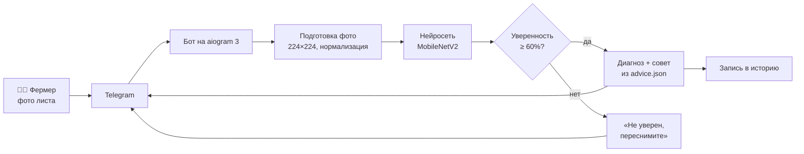

# 🌾 Күріш дәрігері · RiceDoctor

**Telegram-бот, который по фотографии листа риса за несколько секунд называет болезнь, показывает уверенность в процентах и даёт совет фермеру.**

> Күріш жапырағының фотосы бойынша ауруды бірнеше секундта анықтап, фермерге кеңес беретін Telegram-бот.

| | |
|---|---|
| Конкурс | INNOFEST Kyzylorda 2026 (4–5 декабря), направление **AI Software Development** |
| Автор | Санжар, школа программирования GRAND master |
| Наставник | Куанышбаев А. Ж. |
| Статус | 🛠 в разработке, готовность к 3 декабря 2026 |
| Командный проект | [AgroQyzyl](https://github.com/schoolprogramminggm-lab/innofest-agroqyzyl): этот бот работает модулем «диагностика листа» |

---

## 1. Проблема

Рис — главная сельскохозяйственная культура Кызылординской области. Болезни листьев (пирикуляриоз, бурая пятнистость, бактериальный ожог) за несколько недель снижают урожай, а замечают их обычно поздно:

- агроном далеко, его выезд стоит денег и времени;
- фермер не всегда может отличить одну болезнь от другой или от простого пожелтения;
- чем позже начато лечение, тем больше потери.

## 2. Решение

Фермер фотографирует лист на телефон и отправляет фото боту в Telegram. Через 2–5 секунд бот отвечает:

```
🩺 Диагноз: пирикуляриоз (blast)
📊 Уверенность: 91%
💡 Что делать: удалите поражённые листья, снизьте азотные подкормки,
   обработайте поле фунгицидом. Проверьте соседние участки.
```

Если бот не уверен (уверенность ниже 60%), он не гадает, а честно просит переснять:

```
🤔 Не уверен. Сфотографируйте лист ближе, при дневном свете, на однотонном фоне.
```

Telegram есть у каждого фермера, поэтому ставить отдельное приложение не нужно. Бот говорит на **казахском и русском** языках.

## 3. Возможности

| Команда / действие | Что происходит |
|---|---|
| `/start` | Приветствие, выбор языка кнопкой (қазақша / русский), короткая инструкция |
| Отправка фото листа | Диагноз, уверенность в %, совет из 3–4 строк |
| Уверенность < 60% | Ответ «не уверен» с советом, как переснять |
| `/history` | Последние 5 проверок пользователя: дата, диагноз, уверенность |
| `/help` | Как правильно фотографировать лист |

**Распознаваемые классы (минимум 4):**

| Класс | Казахский | Русский | Английский |
|---|---|---|---|
| `healthy` | Сау жапырақ | Здоровый лист | Healthy |
| `blast` | Пирикуляриоз | Пирикуляриоз | Rice blast |
| `brown_spot` | Қоңыр дақ | Бурая пятнистость | Brown spot |
| `bacterial_blight` | Бактериялық күйік | Бактериальный ожог | Bacterial leaf blight |

## 4. Как это работает



1. **Бот** (aiogram 3) принимает фото и скачивает его в память, на диск не сохраняет.
2. **Подготовка:** фото уменьшается до 224×224 пикселей и приводится к виду, на котором обучалась сеть.
3. **Нейросеть MobileNetV2.** Это готовая сеть, уже обученная распознавать тысячи объектов на миллионе фотографий (ImageNet). Мы её **дообучаем** (transfer learning) на фото листьев риса. Поэтому хватает нескольких тысяч фото, а обучение идёт на обычном ноутбуке.
4. **Ответ.** Сеть выдаёт вероятность для каждого класса. Берётся класс с наибольшей вероятностью. Если она ниже 60%, бот отвечает «не уверен».
5. **Совет** берётся из файла `advice/advice.json` на нужном языке.
6. **История.** Сохраняются только дата, диагноз и уверенность (без фото) для команды `/history`.

## 5. Технологии

| Часть | Технология | Зачем |
|---|---|---|
| Язык | Python 3.11 | Основной язык проекта |
| Бот | [aiogram 3](https://docs.aiogram.dev/) | Асинхронный фреймворк для Telegram-ботов |
| Модель | TensorFlow / Keras, MobileNetV2 | Лёгкая сеть для классификации изображений, быстро работает на ноутбуке |
| Изображения | Pillow, NumPy | Загрузка и подготовка фото |
| Настройки | python-dotenv | Токен бота хранится в `.env`, а не в коде |
| История | SQLite (встроен в Python) | Последние проверки пользователей |
| Запасной вариант модели | [Teachable Machine](https://teachablemachine.withgoogle.com/) | Первая рабочая версия без программирования обучения |

Бюджет проекта: **0 тг**, все инструменты и данные бесплатные.

## 6. Данные

Используются открытые наборы фотографий листьев риса с Kaggle / Mendeley Data. Кандидаты (проверить классы и лицензию):

- **Rice Diseases Image Dataset** (Kaggle): классы Healthy, BrownSpot, LeafBlast, Hispa;
- **Rice Leaf Disease Image Samples** (Mendeley Data): классы Bacterialblight, Blast, Brownspot, Tungro.

Если в одном наборе нет нужного класса, наборы объединяются. Фото раскладываются по папкам классов и делятся на **обучающую (80%)** и **проверочную (20%)** части. Проверочные фото сеть при обучении не видит, на них честно меряется точность.

> Папка `data/` не хранится в репозитории (фото весят сотни мегабайт). Каждый скачивает набор сам по инструкции в разделе 8.

| Класс | Фото всего | Обучение (80%) | Проверка (20%) | Источник |
|---|---|---|---|---|
| healthy | — | — | — | — |
| blast | — | — | — | — |
| brown_spot | — | — | — | — |
| bacterial_blight | — | — | — | — |

## 7. Результаты

*Заполняется после обучения модели (этап «Разработка»).*

| Метрика | Требование | Цель | Результат |
|---|---|---|---|
| Точность на проверочной части | ≥ 80% | 90% | — |
| Время ответа на одно фото (ноутбук) | ≤ 5 с | 2–3 с | — |
| Тест на 20 «чужих» фото (не из набора) | — | ≥ 15 из 20 | — |

**Точность по классам:**

| Класс | Precision | Recall | F1 |
|---|---|---|---|
| healthy | — | — | — |
| blast | — | — | — |
| brown_spot | — | — | — |
| bacterial_blight | — | — | — |

## 8. Установка и запуск

**Нужно:** Python 3.11, Git, аккаунт Telegram.

```bash
# 1. Скачать проект
git clone https://github.com/schoolprogramminggm-lab/innofest-rice-doctor.git
cd innofest-rice-doctor

# 2. Виртуальное окружение
python -m venv venv
venv\Scripts\activate          # Windows
# source venv/bin/activate     # Linux / macOS

# 3. Библиотеки
pip install -r requirements.txt

# 4. Настройки: скопировать пример и вписать свой токен
copy .env.example .env         # Windows
# cp .env.example .env         # Linux / macOS
```

Файл `.env`:
```
BOT_TOKEN=токен_от_@BotFather
MODEL_PATH=models/rice_doctor.keras
CONFIDENCE_THRESHOLD=0.60
```

```bash
# 5. Данные: скачать набор с Kaggle и разложить по папкам
#    data/train/<класс>/*.jpg  и  data/val/<класс>/*.jpg

# 6. Обучить модель (один раз, ~20–40 минут на ноутбуке)
python model/train.py

# 7. Запустить бота
python bot/main.py
```

> Обученная модель (`models/*.keras`) в репозиторий не загружается, файл слишком большой. Готовая модель передаётся через общую папку Google Drive.

## 9. Структура проекта

```
innofest-rice-doctor/
├── bot/
│   ├── main.py            # запуск бота
│   ├── handlers.py        # /start, /help, /history, приём фото
│   ├── keyboards.py       # кнопки выбора языка
│   ├── texts.py           # тексты бота на kk / ru
│   └── history.py         # история проверок (SQLite)
├── model/
│   ├── train.py           # дообучение MobileNetV2
│   ├── predict.py         # предсказание по одному фото
│   ├── evaluate.py        # точность и таблица по классам
│   └── classes.json       # список классов
├── advice/
│   └── advice.json        # советы по каждой болезни на kk / ru
├── tests/
│   └── test_predict.py    # проверка предсказания и порога 60%
├── data/                  # фото для обучения (не в git)
├── models/                # обученная модель (не в git)
├── .env.example           # пример настроек без секретов
├── requirements.txt
└── README.md
```

## 10. Безопасность и данные пользователей

- Токен бота хранится **только** в файле `.env`. Файл указан в `.gitignore` и никогда не попадает в репозиторий. В репозитории лежит только `.env.example` без настоящего токена.
- Фото пользователей обрабатываются в памяти и **не сохраняются** на диск.
- В истории хранятся только дата, диагноз и уверенность, без фото и без личных данных.
- Если токен случайно попал в коммит, сразу сообщить наставнику.

## 11. План работы

Задачи ведутся в [Issues](../../issues) и разбиты по [этапам (Milestones)](../../milestones):

| Этап | Срок | Результат |
|---|---|---|
| 1. ТЗ и старт | до 7 ноября | Окружение, данные скачаны, бот отвечает на `/start` и принимает фото |
| 2. Прототипы | до 14 ноября | Первая модель, бот отдаёт диагноз, советы в JSON |
| 3. Разработка | до 21 ноября | Точность ≥ 80%, порог «не уверен», `/history`, модуль для AgroQyzyl |
| 4. Доводка | до 28 ноября | Тест на чужих фото, слайды, финальный README |
| 5. Защита | до 3 декабря | Репетиции, выступление 3 минуты |

**Правила работы:**
1. Каждое занятие начинается с отчёта на 2 минуты: что сделал, что делаю сегодня.
2. Коммит в конце каждого занятия с понятным описанием на русском или казахском.
3. В 16:25 наставник проверяет задачи дня.
4. Всё, что показываем на сцене, работает вживую. Видео-демо только запасной вариант.

## 12. Демонстрация на INNOFEST

В декабре риса в поле нет, поэтому для демо распечатываются фото здоровых и больных листьев. Член жюри сам фотографирует любой лист своим телефоном, отправляет боту и видит диагноз.

---

*Проект подготовлен в школе программирования GRAND master, Кызылорда, 2026.*
