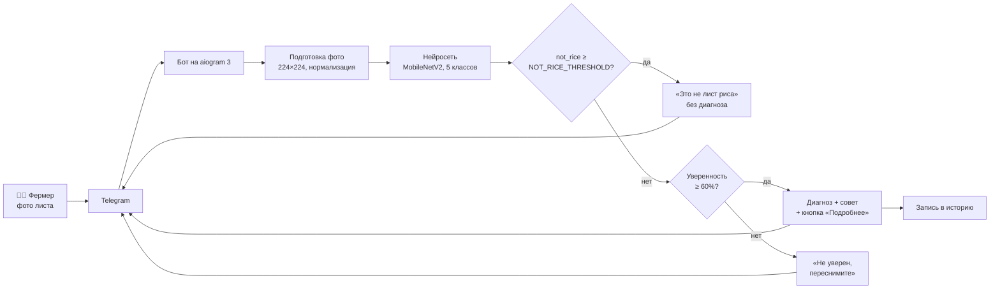

# 🌾 RiceDoctor AI · Күріш дәрігері AI

**Telegram-бот, который по фотографии листа риса за несколько секунд называет болезнь, показывает уверенность в процентах и даёт совет фермеру.**

> Күріш жапырағының фотосы бойынша ауруды бірнеше секундта анықтап, фермерге кеңес беретін Telegram-бот.

| | |
|---|---|
| Конкурс | INNOFEST Kyzylorda 2026 (4–5 декабря), направление **AI Software Development** |
| Автор | Санжар, школа программирования GRAND master |
| Наставник | Куанышбаев А. Ж. |
| Статус | 🛠 в разработке, готовность к 3 декабря 2026 |
| Командный проект | AgroQyzyl: командный бот живёт модулем внутри этого бота (RiceDoctor), здесь же модуль «диагностика листа» |

---

## 1. Проблема

Рис — главная сельскохозяйственная культура Кызылординской области. Болезни листьев (пирикуляриоз, бурая пятнистость, бактериальный ожог) за несколько недель снижают урожай, а замечают их обычно поздно:

- агроном далеко, его выезд стоит денег и времени;
- фермер не всегда может отличить одну болезнь от другой или от простого пожелтения;
- чем позже начато лечение, тем больше потери.

## 2. Решение

Фермер фотографирует лист на телефон и отправляет фото боту в Telegram. Через 2–5 секунд бот отвечает коротко, а под ответом есть кнопка **«Подробнее»**:

```
🩺 Диагноз: Пирикуляриоз
📊 Уверенность: 91%
💡 Что делать:
• Удалите поражённые листья и вывезите их с поля.
• Снизьте азотные подкормки и вносите азот частями, а не сразу.
• ...
[ Подробнее ]
```

Уверенность бот показывает **не больше 99%**: нейросеть не бывает уверена на 100%, поэтому 0,9999 выводится как «99%».

Если бот не уверен (уверенность ниже 60%), он не гадает, а честно просит переснять:

```
🤔 Не уверен. Сфотографируйте лист ближе, при дневном свете.
```

Если на фото вообще не лист риса (кошка, человек, комната, документ), диагноза нет:

```
Это не похоже на лист риса. Сфотографируйте лист ближе.
```

### Структура ответа бота

| Часть | Когда | Что внутри | Кнопка |
|---|---|---|---|
| **Короткий ответ** | Диагноз поставлен (уверенность ≥ 60%) | Диагноз, уверенность (≤ 99%), 3–4 строки совета | «Подробнее» |
| **Подробный ответ** | Нажата кнопка «Подробнее» (новое сообщение, кнопка пропадает) | 5 разделов (см. ниже) и напоминание, что бот не заменяет агронома | нет |
| «Не уверен» | Уверенность ниже 60% | Просьба переснять фото | нет |
| «Не лист риса» | Вероятность `not_rice` не ниже `NOT_RICE_THRESHOLD` | «Это не похоже на лист риса. Сфотографируйте лист ближе.» (kk / ru), без диагноза и процентов | нет |

Пять разделов подробного ответа (для каждой болезни и для здорового листа, на казахском и русском):

1. 🔍 **Как узнать:** признаки на листе и чем болезнь отличается от других;
2. ⚠️ **Насколько опасно:** как быстро развивается и что теряет урожай;
3. 📅 **Что сделать в первые 3 дня:** по дням, с учётом чеков, воды и засоления;
4. 🌱 **Профилактика на следующий сезон:** сорта, семена, азот, вода, дренаж, севооборот;
5. 📞 **Когда срочно звать агронома.**

Тексты хранятся в `advice/advice.json`: для каждого класса и языка поля `name`, `advice` (короткий совет), `signs`, `danger`, `first_3_days`, `prevention`, `call_agronomist`. Названий фунгицидов и доз в текстах нет.

Telegram есть у каждого фермера, поэтому ставить отдельное приложение не нужно. Бот говорит на **казахском и русском** языках.

## 3. Возможности

| Команда / действие | Что происходит |
|---|---|
| `/start` | Приветствие, выбор языка кнопкой (қазақша / русский), короткая инструкция |
| Отправка фото листа | Диагноз, уверенность в % (не больше 99%), совет из 3–4 строк, кнопка «Подробнее» |
| Кнопка «Подробнее» | Подробный ответ: как узнать, насколько опасно, первые 3 дня, профилактика, когда звать агронома |
| Фото не листа риса | «Это не похоже на лист риса. Сфотографируйте лист ближе», без диагноза |
| Уверенность < 60% | Ответ «не уверен» с советом, как переснять |
| `/history` | Последние 5 проверок пользователя: дата, диагноз, уверенность |
| `/help` | Как правильно фотографировать лист |

**Распознаваемые классы (4 состояния листа + 1 служебный):**

| Класс | Казахский | Русский | Английский |
|---|---|---|---|
| `healthy` | Сау жапырақ | Здоровый лист | Healthy |
| `blast` | Пирикуляриоз | Пирикуляриоз | Rice blast |
| `brown_spot` | Қоңыр дақ | Бурая пятнистость | Brown spot |
| `bacterial_blight` | Бактериялық күйік | Бактериальный ожог | Bacterial leaf blight |
| `not_rice` | Күріш жапырағы емес | Не лист риса | Not a rice leaf |

`not_rice` не болезнь: для него нет советов, бот отвечает только «это не лист риса».

## 4. Как это работает



1. **Бот** (aiogram 3) принимает фото и скачивает его в память, на диск не сохраняет.
2. **Подготовка:** фото уменьшается до 224×224 пикселей и приводится к виду, на котором обучалась сеть.
3. **Нейросеть MobileNetV2.** Это готовая сеть, уже обученная распознавать тысячи объектов на миллионе фотографий (ImageNet). Мы её **дообучаем** (transfer learning) на фото листьев риса. Поэтому хватает нескольких тысяч фото, а обучение идёт на обычном ноутбуке.
4. **Ответ.** Сеть выдаёт вероятность для каждого из 5 классов.
   - Если вероятность `not_rice` не ниже порога `NOT_RICE_THRESHOLD` (по умолчанию 0,50), бот отвечает «это не лист риса» и диагноз не ставит. Порог — одна переменная в `.env`, читается только в `model/predict.py`.
   - Иначе берётся болезнь (или здоровый лист) с наибольшей вероятностью. Если она ниже 60%, бот отвечает «не уверен».
   - Уверенность в процентах показывается не больше 99% (функция `percent()` в `model/predict.py`).
5. **Совет** берётся из файла `advice/advice.json` на нужном языке: короткий совет сразу, подробный по кнопке «Подробнее».
6. **История.** Сохраняются только дата, диагноз и уверенность (без фото) для команды `/history`.
7. **JSON для AgroQyzyl.** Для командного бота результат можно получить в едином формате с обеими программами проекта (диагноз, уверенность, советы на kk и ru, флаг `ok`): `to_agroqyzyl(класс, уверенность)` в `bot/agroqyzyl.py`. Формат: [docs/agroqyzyl-format.md](docs/agroqyzyl-format.md), пример: `examples/agroqyzyl_rice_doctor.json`. Если сеть не уверена, `ok` равен `false`, а в `error` написана причина. Если на фото не лист риса, `ok` тоже `false`, `result` равен `null`, а в `message` написано «Это не похоже на лист риса…» на двух языках.

## 5. Технологии

| Часть | Технология | Зачем |
|---|---|---|
| Язык | Python 3.10 | Основной язык проекта |
| Бот | [aiogram 3](https://docs.aiogram.dev/) | Асинхронный фреймворк для Telegram-ботов |
| Модель | TensorFlow / Keras, MobileNetV2 | Лёгкая сеть для классификации изображений, быстро работает на ноутбуке |
| Изображения | Pillow, NumPy | Загрузка и подготовка фото |
| Настройки | python-dotenv | Токен бота хранится в `.env`, а не в коде |
| История | SQLite (встроен в Python) | Последние проверки пользователей |
| Запасной вариант модели | [Teachable Machine](https://teachablemachine.withgoogle.com/) | Первая рабочая версия без программирования обучения |

Бюджет проекта: **0 тг**, все инструменты и данные бесплатные.

## 6. Данные

Модели v1–v3 учились на одном открытом наборе — **Paddy Doctor**: фото листьев риса, снятые на полях в Индии (штат Тамилнаду), размер 480×640. Для дообучения на разных источниках (issue #23) добавлено ещё 4 источника с лицензией CC BY 4.0: см. «Данные из нескольких источников» ниже.

- **Источник:** [Kaggle: Paddy Doctor: Paddy Disease Classification](https://www.kaggle.com/competitions/paddy-disease-classification) (обучающая часть, 10 407 фото, 10 классов); полная версия — [IEEE DataPort](https://ieee-dataport.org/node/10108).
- **Лицензия:** [CC BY 4.0](https://creativecommons.org/licenses/by/4.0/) — можно использовать, в том числе на конкурсе, с указанием авторов.
- **Авторы:** Petchiammal A., Briskline Kiruba S., D. Murugan, Pandarasamy A. *Paddy Doctor: A Visual Image Dataset for Automated Paddy Disease Classification and Benchmarking.* CODS-COMAD 2023. [doi:10.1145/3570991.3570994](https://doi.org/10.1145/3570991.3570994), [arXiv:2205.11108](https://arxiv.org/abs/2205.11108).

Из 10 классов набора берём 4. Папки переименовываются под наши названия: `normal` → `healthy`, `bacterial_leaf_blight` → `bacterial_blight`, `blast` и `brown_spot` без изменений. Скрипт `model/prepare_data.py` уменьшает фото до 256 пикселей по длинной стороне и делит каждый класс на **обучающую (80%)** и **проверочную (20%)** части (деление всегда одинаковое, seed = 42). Проверочные фото сеть при обучении не видит, на них честно меряется точность.

Классы **не урезаются** до одинакового размера. Бактериального ожога в наборе почти в 4 раза меньше, чем здоровых листьев, поэтому при обучении редкие классы получают больший вес (`class_weight`): ошибка на них «штрафуется» сильнее.

### Пятый класс `not_rice` («не лист риса»)

Чтобы бот не ставил диагноз кошке или человеку, сеть обучена ещё на **500 посторонних фото**: другие растения (листья, трава, цветы, деревья, комнатные растения), люди, животные (кошки, собаки, птицы), предметы (машины, здания, стулья, столы, ноутбуки), тексты и книги.

- **Источник:** [Open Images V7](https://storage.googleapis.com/openimages/web/index.html) (проверочная часть, Google). Метки фото: [CC BY 4.0](https://creativecommons.org/licenses/by/4.0/).
- **Лицензия фото:** берутся только фото с лицензией [CC BY 2.0](https://creativecommons.org/licenses/by/2.0/) (Flickr): можно использовать с указанием автора. Автор и ссылка на каждое фото записываются скриптом в `data/not_rice_sources.csv` (файл в git не входит, но воспроизводится запуском скрипта).
- **Как скачать:** `python model/download_not_rice.py`. Фото выбираются случайно (seed = 42), уменьшаются до 256 пикселей, делятся 400 на обучение и 100 на проверку.
- Состав по понятиям: Leaf 50, Person 60, Houseplant 35, Cat 35, Dog 35, Grass 30, Flower 30, Tree 25, Bird 25, Car 25, Building 25, Text 25, Chair 20, Table 20, Laptop 20, Book 20, Poster 20.

| Класс | Фото всего | Обучение | Проверка | Источник |
|---|---|---|---|---|
| not_rice | 500 | 400 | 100 | Open Images V7, CC BY 2.0 |

> Папка `data/` не хранится в репозитории (фото весят сотни мегабайт). Каждый скачивает набор сам по инструкции в разделе 8. Модель (`models/*.keras`) тоже не коммитится.

| Класс | Фото всего | Обучение (80%) | Проверка (20%) | Источник (папка Paddy Doctor) |
|---|---|---|---|---|
| healthy | 1764 | 1411 | 353 | `normal` |
| blast | 1738 | 1390 | 348 | `blast` |
| brown_spot | 965 | 772 | 193 | `brown_spot` |
| bacterial_blight | 479 | 383 | 96 | `bacterial_leaf_blight` |
| **Всего** | **4946** | **3956** | **990** | |

## 7. Результаты

*Модель v2, 13.11.2026. Обучение на процессоре Intel Core i7-9700K, без видеокарты.*

| Метрика | Требование | Цель | Результат |
|---|---|---|---|
| Точность на проверочной части | ≥ 80% | 90% | **96,6%** (990 фото) |
| Время ответа на одно фото (ноутбук) | ≤ 5 с | 2–3 с | **0,9 с** (без загрузки модели) |
| Тест на «чужих» фото (не из Paddy Doctor), 28 листьев, бот на v3 | — | ≥ 15 из 20 | **не выполнен: 6 из 28 (21%)**; v4 (в бота не включена): 22 из 28, но фото уже не «чужие» для неё, см. [docs/accuracy-external.md](docs/accuracy-external.md) |

**Как обучали** — две версии модели:

| Версия | Скрипт | Что обучается | Эпох | Точность на проверке | Время |
|---|---|---|---|---|---|
| v1, шаг 1 | `model/train.py` | Только наш верхний слой (MobileNetV2 заморожена) | 5 | 65,7% | 4,7 мин |
| v1, шаг 2 | `model/train.py` | + верхние 30 слоёв MobileNetV2, скорость 1e-5 | 15 | 81,3% | 15,8 мин |
| **v2** | `model/finetune.py` | Дообучение v1: верхние 30 слоёв, скорость 1e-4 → 1e-5, мягкие веса классов | 25 | **96,6%** | 26,7 мин |

Что изменилось в v2:
- **Скорость обучения** сначала в 10 раз больше (1e-4), а когда точность перестаёт расти, автоматически уменьшается до 1e-5 (`ReduceLROnPlateau`).
- **Веса классов мягче** — корень из обычного веса (bacterial_blight: 2,58 → 1,61). Сеть перестала «перестраховываться» и называть бактериальный ожог где попало.

**Матрица ошибок v2** (строка — что на фото на самом деле, столбец — что ответила сеть; на диагонали — верные ответы):

| На самом деле \ Ответ | healthy | blast | brown_spot | bacterial_blight |
|---|---|---|---|---|
| healthy | **345** | 3 | 3 | 2 |
| blast | 5 | **339** | 4 | 0 |
| brown_spot | 1 | 6 | **182** | 4 |
| bacterial_blight | 0 | 4 | 2 | **90** |

**Точность по классам, v1 → v2:**

| Класс | Precision v1 → v2 | Recall v1 → v2 | F1 v1 → v2 | Фото |
|---|---|---|---|---|
| healthy | 0.87 → **0.98** | 0.96 → **0.98** | 0.91 → **0.98** | 353 |
| blast | 0.94 → **0.96** | 0.69 → **0.97** | 0.80 → **0.97** | 348 |
| brown_spot | 0.80 → **0.95** | 0.75 → **0.94** | 0.77 → **0.95** | 193 |
| bacterial_blight | 0.50 → **0.94** | 0.86 → **0.94** | 0.63 → **0.94** | 96 |

**Что видно:**
- Все четыре класса теперь распознаются с точностью 94–98%.
- Главное улучшение — **blast**: v1 находила только 69% таких фото, v2 — 97%.
- Ложных «бактериальных ожогов» почти нет: precision 0.50 → 0.94.
- Порог 60%: сеть уверена на 98% фото, и среди этих ответов верных 97%. Только 2% фото получают ответ «не уверен».
- **Осторожно:** лучшая эпоха выбиралась по этим же проверочным фото, поэтому 96,6% — немного оптимистичная оценка. Все фото сняты в одном регионе Индии. Честная проверка — тест на «чужих» фото (строка 3 первой таблицы): на нём модель угадала всего 21% листьев, подробности в [docs/accuracy-external.md](docs/accuracy-external.md).

### Данные из нескольких источников (issue #23, 19.11.2026)

Модель v3 на фото из других наборов угадывала 21%. Поэтому собран набор из 6 источников (7824 фото); у каждого фото в **`data/sources.csv`** записаны источник, лицензия, класс, исходное имя файла и sha256. Сами фото в git не входят, их скачивает `python model/download_sources.py`.

| Источник | Лицензия | Фото |
|---|---|---|
| Paddy Doctor (Индия, поле) | CC BY 4.0 | 4946 |
| Mendeley «Rice Leaf Bacterial and Fungal Disease» (Бангладеш, поле), [doi:10.17632/hx6f852hw4.2](https://doi.org/10.17632/hx6f852hw4.2) | CC BY 4.0 | 863 |
| Mendeley «RiceLeafBD» (Бангладеш, поле), [doi:10.17632/kx9rx8p2mz.1](https://doi.org/10.17632/kx9rx8p2mz.1) | CC BY 4.0 | 1030 |
| UCI «Rice Leaf Diseases» (Индия, лист на белом фоне), [doi:10.24432/C5R013](https://doi.org/10.24432/C5R013) | CC BY 4.0 | 74 |
| Mendeley «Dhan-Shomadhan» (Бангладеш, поле и белый фон), [doi:10.17632/znsxdctwtt.1](https://doi.org/10.17632/znsxdctwtt.1) | CC BY 4.0 | 411 |
| Open Images V7 (посторонние фото, класс `not_rice`) | CC BY 2.0 | 500 |

33 фото из `eval/images/` в обучение не попадают (проверка по хешу файла, по имени исходного файла и по «похожему хешу»; тест `tests/test_no_leak.py`). Подробности: [docs/accuracy-external.md](docs/accuracy-external.md).

### Модель v4 (дообучение на разных источниках, 19.11.2026): **бот остаётся на v3**

Обучение: `python model/train_multi.py all` (проверка «по источнику» и финальная модель `models/rice_doctor_v4.keras`, около 45 минут на процессоре). Критерии переключения бота на v4 и результат:

| Критерий | Требование | v4 | |
|---|---|---|---|
| Отложенные источники в среднем (4 класса) | ≥ 70% | **37,6%** (v3: 10,1% на 4 чужих источниках) | ❌ |
| Paddy Doctor (990 проверочных фото) | ≥ 90% | 90,2% (v3: 96,6%) | ✅ |
| «Не рис» на 5 чужих фото | отвергаются | 5 из 5 | ✅ |

Первый критерий не выполнен, поэтому **бот работает на v3**, issue #23 и #13 остаются открытыми. На 33 чужих фото v4 даёт 22 из 28 листьев (v3: 6 из 28), но это уже не независимая проверка: в обучении теперь есть другие фото тех же наборов. Таблицы по источникам и классам, ошибки и «чего не хватило»: [docs/accuracy-external.md](docs/accuracy-external.md).

### Модель v3: добавлен класс `not_rice` (17.11.2026)

Проверочная часть: те же 990 фото листьев + 100 новых посторонних фото (всего 1090). Ответы считаются так, как их увидит пользователь (с порогом `NOT_RICE_THRESHOLD = 0,50`): `python model/evaluate.py models/rice_doctor_v3.keras`.

| Метрика | v2 (4 класса) | v3 (5 классов) |
|---|---|---|
| Точность по 4 болезням (990 фото листьев) | **96,6%** (956 верно) | **96,5%** (955 верно) |
| Точность по всем классам (1090 фото) | — | 96,6% |
| Посторонние фото: получили диагноз с уверенностью ≥ 60% (ошибка) | 93 из 100 | — |
| Посторонние фото: распознаны как «не лист риса» | — | **98 из 100** |
| Настоящие листья, ошибочно названные «не лист» | — | 1 из 990 |

**Точность по классам, было (v2) → стало (v3):**

| Класс | Precision | Recall | F1 | Фото |
|---|---|---|---|---|
| healthy | 0.98 → 0.98 | 0.98 → 0.97 | 0.98 → 0.98 | 353 |
| blast | 0.96 → 0.96 | 0.97 → 0.97 | 0.97 → 0.97 | 348 |
| brown_spot | 0.95 → 0.95 | 0.94 → 0.94 | 0.95 → 0.95 | 193 |
| bacterial_blight | 0.94 → 0.94 | 0.94 → 0.94 | 0.94 → 0.94 | 96 |
| not_rice | не было (диагноз ставился любому фото) → **0.99** | → **0.98** | → **0.98** | 100 |

**Матрица ошибок v3** (строка — что на фото на самом деле, столбец — ответ сети):

| На самом деле \ Ответ | healthy | blast | brown_spot | bacterial_blight | not_rice |
|---|---|---|---|---|---|
| healthy | **344** | 3 | 3 | 2 | 1 |
| blast | 5 | **339** | 4 | 0 | 0 |
| brown_spot | 1 | 6 | **182** | 4 | 0 |
| bacterial_blight | 0 | 4 | 2 | **90** | 0 |
| not_rice | 1 | 0 | 1 | 0 | **98** |

**Как получена v3** (`model/finetune.py`):
- Взяли v2 и добавили пятый выход. Шаг 1: сеть заморожена, учится только выход `not_rice`, четыре выхода болезней остаются такими же, как у v2 (поэтому болезни определяются почти так же, как раньше).
- Шаг 2 (дообучение верхних 30 слоёв MobileNetV2) в сохранённую модель ничего не добавил: точность по болезням не росла, и модель шага 1 осталась финальной.
- Раньше пробовали дообучать верхние слои сразу вместе с новым выходом (3 запуска): точность по болезням получалась 96,0–96,4%, то есть хуже, поэтому выбран описанный выше путь.

**Что видно и оговорки:**
- Точность по болезням упала на **одно фото** из 990 (956 → 955; 96,57% → 96,46%): строго говоря, 96,5% чуть ниже прежних 96,6%. Это одно настоящее здоровое фото, которое сеть назвала «не листом».
- Как и у v2, лучший вариант выбирался по проверочным фото, поэтому оценка немного оптимистична. Проверочные посторонние фото взяты из того же набора Open Images, что и обучающие.
- Дополнительная проверка на других данных (скрипт не в репозитории): 150 посторонних фото из **других** понятий Open Images (еда, бутылки, лодки, мебель, окна, игрушки, одежда, насекомые и т. п.): 144 найдены как «не лист» (96%). 210 листьев риса с **другими болезнями** из Paddy Doctor (другие 6 классов, в обучение не входили): 3 ошибочно названы «не лист» (1,4%).
- Тест на «чужих» фото из других источников проведён 18.11.2026 ([отчёт](docs/accuracy-external.md)): листья риса 6 из 28 верно (21%), «не рис» 5 из 5. После дообучения на разных источниках (v4) на тех же фото 22 из 28, но v4 в бота не включена, см. выше. Пока порог 0,50 стоит по умолчанию; если бот слишком часто отвергает настоящие листья, поднимите `NOT_RICE_THRESHOLD` в `.env`.

## 8. Установка и запуск

**Нужно:** Python 3.10, Git, аккаунт Telegram.

```bash
# 1. Скачать проект
git clone https://github.com/schoolprogramminggm-lab/innofest-rice-doctor.git
cd innofest-rice-doctor

# 2. Виртуальное окружение
py -3.10 -m venv .venv
.venv\Scripts\activate         # Windows
# python3.10 -m venv .venv && source .venv/bin/activate   # Linux / macOS

# 3. Библиотеки
pip install -r requirements.txt

# 4. Настройки: скопировать пример и вписать свой токен
copy .env.example .env         # Windows
# cp .env.example .env         # Linux / macOS
```

Файл `.env`:
```
BOT_TOKEN=токен_от_@BotFather
MODEL_PATH=models/rice_doctor.keras
CONFIDENCE_THRESHOLD=0.60
NOT_RICE_THRESHOLD=0.50
```

`CONFIDENCE_THRESHOLD`: ниже этой уверенности бот отвечает «не уверен». `NOT_RICE_THRESHOLD`: если вероятность «не лист риса» не ниже этого числа, бот отвечает «это не лист риса» и диагноза не ставит. Чем меньше число, тем чаще бот отвергает фото.

```bash
# 5. Данные: скачать архив Paddy Doctor с Kaggle (вкладка Data, ~1 ГБ)
#    и распаковать в data/raw/ (должно получиться data/raw/train_images/<класс>/*.jpg).
#    Затем уменьшить фото и разделить на data/train и data/val:
python model/prepare_data.py

# 5б. Посторонние фото для класса not_rice (500 фото из Open Images, CC BY 2.0, нужен интернет)
python model/download_not_rice.py

# 6. Обучить модель (один раз, ~50 минут на процессоре)
#    v1 и v2 учились на 4 классах (до появления not_rice); их файлы: models/rice_doctor_v1.keras,
#    models/rice_doctor_v2.keras. Для v3 нужна готовая v2 (её можно взять с общего диска).
python model/finetune.py    # v3 = v2 + класс not_rice, 5–40 мин -> models/rice_doctor_v3.keras и models/classes.json
copy models\rice_doctor_v3.keras models\rice_doctor.keras   # сделать v3 основной

# 7. Проверить точность и попробовать одно фото
python model/evaluate.py
python model/predict.py data/val/blast/<любое_фото>.jpg

# 7б. Проверить на «чужих» фото (33 фото из других наборов, лежат в eval/images/):
python eval/run_eval.py     # accuracy, F1 по классам, матрица ошибок, время на фото, все ошибки
python eval/run_eval.py models/rice_doctor_v4.keras   # другая модель; ответы: eval/results_<имя модели>.csv

# 7в. Дообучение на нескольких источниках (issue #23, нужен интернет, ~3 ГБ):
python model/download_sources.py      # скачать 4 набора, собрать data/multi и data/sources.csv (без 33 eval-фото)
python model/train_multi.py all       # проверка «по источнику» (eval/loso_results.csv) + models/rice_doctor_v4.keras
# Бот переключается на v4 только если выполнены критерии (см. раздел 7); сейчас он работает на v3.

# 8. Запустить бота (из корня проекта; модель и токен нужны, см. выше)
python bot/main.py

# 9. Тесты (без сети и без настоящей модели)
python -m pytest
```

> Обученная модель (`models/*.keras`) в репозиторий не загружается, файл слишком большой. Готовая модель передаётся через общую папку Google Drive.

## 9. Структура проекта

```
innofest-rice-doctor/
├── bot/
│   ├── main.py            # запуск бота
│   ├── handlers.py        # /start, /help, /history, приём фото
│   ├── keyboards.py       # кнопки: выбор языка, «Подробнее»
│   ├── texts.py           # тексты бота на kk / ru, format_answer() (короткий), format_details() (подробный)
│   ├── agroqyzyl.py       # to_agroqyzyl(): ответ в едином JSON для AgroQyzyl
│   ├── users.py           # запоминает язык пользователя (data/user_langs.json)
│   └── history.py         # история проверок (SQLite)
├── model/
│   ├── prepare_data.py    # 4 класса болезней из data/raw -> data/train и data/val
│   ├── download_not_rice.py  # 500 посторонних фото для класса not_rice (Open Images, CC BY 2.0)
│   ├── download_sources.py   # 4 дополнительных набора -> data/multi и data/sources.csv; убирает фото из eval
│   ├── train_multi.py     # v4: дообучение на разных источниках + проверка «по источнику» (loso)
│   ├── evaluate_sources.py   # точность модели по источникам и классам (колонка «было»)
│   ├── train.py           # дообучение MobileNetV2 (версия v1)
│   ├── finetune.py        # v2 -> v3: добавляет класс not_rice
│   ├── predict.py         # предсказание по одному фото, порог not_rice, percent() не больше 99%
│   └── evaluate.py        # точность и таблица по классам, проверка порога not_rice
├── eval/
│   ├── images/            # 33 чужих фото (28 листьев риса и 5 «не рис»), не из Paddy Doctor
│   ├── labels.csv         # эталон: file, expected, source, license
│   ├── run_eval.py        # прогон набора через настоящую модель (accuracy, F1, матрица ошибок, время)
│   ├── results_<модель>.csv  # ответы модели по каждому фото (пишет run_eval.py)
│   ├── loso_results.csv   # проверка «по источнику» (train_multi.py loso)
│   ├── v4_results.csv     # v4 на фото Paddy Doctor и Open Images, которых сеть не видела
│   └── sources_v3.csv     # v3 по источникам и классам (evaluate_sources.py)
├── advice/
│   └── advice.json        # короткие и подробные советы по каждой болезни на kk / ru
├── tests/
│   ├── images/            # 2 тестовых фото (лист риса, кошка) и SOURCES.md с лицензиями
│   ├── test_predict.py    # predict() с подменённой моделью: порог 60%, not_rice, 99%
│   ├── test_texts.py      # format_answer / format_details на kk / ru, «не лист риса», 99%
│   ├── test_advice.py     # advice.json: все классы, все поля, оба языка
│   ├── test_handlers.py   # кнопка «Подробнее»
│   ├── test_agroqyzyl.py  # JSON для AgroQyzyl: ключи, kk/ru, «не уверен», not_rice
│   ├── test_real_model.py # настоящая модель на 2 фото (пропускается, если модели нет)
│   ├── test_multi_sources.py # хеши, EXIF, фон-аугментация, лимит фото по источникам
│   └── test_no_leak.py    # фото из eval/ нет в data/sources.csv
├── examples/
│   └── agroqyzyl_rice_doctor.json  # пример ответа для AgroQyzyl
├── data/                  # фото для обучения (не в git), кроме sources.csv: источник и лицензия каждого фото
├── models/                # rice_doctor.keras + classes.json (не в git)
├── docs/                  # задачи, заметки, agroqyzyl-format.md (единый формат JSON), accuracy-external.md (проверка на чужих фото)
├── .env.example           # пример настроек без секретов
├── requirements.txt
└── README.md
```

## 10. Советы фермеру: источники

Тексты в `advice/advice.json` (название и 3–4 строки совета для каждого класса, на казахском и русском) составлены по общим рекомендациям открытых материалов по защите риса:

- [IRRI Rice Knowledge Bank](http://www.knowledgebank.irri.org/): раздел о болезнях риса (пирикуляриоз, бурая пятнистость, бактериальный ожог): баланс азота, ровный уровень воды, чистые семена и устойчивые сорта, уборка заражённых остатков.
- [FAO](https://www.fao.org/): материалы по защите риса и интегрированной борьбе с вредителями и болезнями.

Подробные ответы (признаки, опасность, первые 3 дня, профилактика, когда звать агронома) написаны с учётом условий Кызылординской области: рис растёт в чеках под слоем воды, воду подают по оросителям (болезнь может идти по воде из чека в чек), почвы часто засолены (засоление ослабляет растения, а пересыхание чека подтягивает соль к корням), поэтому в советах есть промывка, коллекторно-дренажная сеть, ровный уровень воды и севооборот рис — люцерна.

Названия фунгицидов и дозы в советах **намеренно не указаны**: их подбирает агроном для конкретного поля.

> ⚠️ **Тексты должен проверить наставник** (казахский и русский), прежде чем бот будет показан на конкурсе. Советы написаны по общим рекомендациям и ещё не сверены постранично с первоисточниками; точные ссылки на страницы IRRI/FAO нужно добавить при проверке. Особенно нужно проверить казахский язык и местные рекомендации (сроки, сорта, промывка полей) у агронома Кызылординской области.

## 11. Безопасность и данные пользователей

- Токен бота хранится **только** в файле `.env`. Файл указан в `.gitignore` и никогда не попадает в репозиторий. В репозитории лежит только `.env.example` без настоящего токена.
- Фото пользователей обрабатываются в памяти и **не сохраняются** на диск.
- Для каждого пользователя запоминается только выбранный язык (`kk` / `ru`) и номер пользователя в Telegram.
- В истории хранятся только дата, диагноз и уверенность, без фото и без личных данных.
- Если токен случайно попал в коммит, сразу сообщить наставнику.

## 12. План работы

Задачи ведутся в [Issues](../../issues) и разбиты по [этапам (Milestones)](../../milestones):

| Этап | Срок | Результат |
|---|---|---|
| 1. ТЗ и старт | до 7 ноября | Окружение, данные скачаны, бот отвечает на `/start` и принимает фото |
| 2. Прототипы | до 14 ноября | Первая модель, бот отдаёт диагноз, советы в JSON |
| 3. Разработка | до 21 ноября | Точность ≥ 80%, порог «не уверен», `/history`, модуль для AgroQyzyl |
| 4. Доводка | до 28 ноября | Тест на чужих фото, слайды, финальный README |
| 5. Защита | до 3 декабря | Репетиции, выступление 3 минуты |

**Правила работы:**
1. Каждое занятие начинается с отчёта на 2 минуты: что сделал, что делаю сегодня.
2. Коммит в конце каждого занятия с понятным описанием на русском или казахском.
3. В 16:25 наставник проверяет задачи дня.
4. Всё, что показываем на сцене, работает вживую. Видео-демо только запасной вариант.

## 13. Демонстрация на INNOFEST

В декабре риса в поле нет, поэтому для демо распечатываются фото здоровых и больных листьев. Член жюри сам фотографирует любой лист своим телефоном, отправляет боту и видит диагноз.

---

*Проект подготовлен в школе программирования GRAND master, Кызылорда, 2026.*
